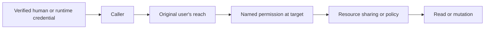

# Organization scope and repository authorization

This document describes the authorization boundary for data with an
`organization_id`. Read it before adding a repository, an SDK operation, or a
route that selects or changes an organization-scoped row.

`OrgScopedRepository` in `org_scoped.py` owns the org/global **resolution
cascade** and the resource-sharing check. It is not an authorization
substitute. Current route and SDK admission uses the caller and permission
services in `src.services.authorization`.

## Authority model

Authorization starts from database-backed facts. `load_caller` builds an
`AuthorizationContext` for a direct user. `runtime_auth.load_runtime_principal`
reconstructs a runtime principal from its typed credential and the durable run,
then `load_caller` uses the run's original user context. Claims describing a
runtime, an organization, or a role do not become authority by themselves.

For a runtime, the **original user** supplies organization reach and named
permission context. The **effect actor** is the account recorded as performing
the run. Keep those facts separate: the actor is useful for attribution and
effects, but must not widen the original user's access.

`RuntimeAuthority` is loaded from the current database state for workflow
executions, service attempts, and agent runs. A missing, ended, or inconsistent
record is rejected. A fixed transport account or provider-organization
membership never grants this authority.

### Reach, scope, and permissions

`shared.scope_resolver.resolve_effective_scope` is the one scope resolver for
SDK-style calls. Its input is one of three distinct values:

| Requested scope | Meaning | Result |
| --- | --- | --- |
| `UNSET` | No target was supplied | The caller's default scope |
| UUID | An explicit organization | That organization, if in original-user reach |
| `None` | Explicit Global | Global, if in original-user reach |

`UNSET` and explicit Global must remain distinct. The resolver uses
`user_reach(caller)` and raises `ScopeNotAllowed` when the selected target is
outside that reach. Scope selection establishes *where* an operation is aimed;
it does not grant an operation. Check the named permission separately at the
actual target with `allows_permission` or `require_named_permission`.

`permitted_organizations(caller, permission)` is useful for discovery and for
filtering a list before pagination. Do not turn a list-level result into a
row-level decision. Once a persisted row is selected, read or mutate it against
its actual `organization_id`; `None` is the Global target. A Global fallback
read may use `shared_read_organization` only when the caller selected a
non-Global default scope. Explicit Global remains Global. Mutations always use
the persisted row target. A move must authorize both its source and destination.

Role boundaries define where a permission applies:

- A base role applies at the user's home organization (or Global for a
  Global-home user).
- An organization boundary applies at that exact organization.
- A managed-organizations boundary applies across managed customer
  organizations.
- A platform boundary applies at Global.

Platform Admin authority comes from a wildcard role grant at the platform
boundary. It is not a boolean copied from a request or inferred from provider
membership. The wildcard still excludes the permissions listed in
`WILDCARD_EXCLUDED_PERMISSIONS`.

### Runtime workflow powers

Workflow powers supplement a runtime operation only after the original user's
reach has accepted the target:

- A **Full** workflow supplies its named powers within the original user's
  reach.
- A **Restricted** workflow supplies only its configured grants, also within
  that reach.
- Agent runs and inline executions add no workflow powers.

Full workflow power is internal authority, not a role assignment. In row
policies, `user.is_platform_admin` means membership in the built-in Platform
Admin role. A Full workflow can supply the separate
`authority.platform_admin` policy authority without changing the user fields or
role IDs visible to policy expressions. Policy rows still decide table and file
data after resource admission.

## Repository resolution and resource sharing

### Ordinary App, Form, and Agent visibility

`shared.resource_access.ResourceAccessResolver` owns the complete visibility
decision for Apps, Forms, and Agents. Both discovery and exact reads use its
`can_read` decision; `filter_readable` applies that same decision to a collection.
It checks the original user's organization reach, resolves the named read
permission target, then applies the resource's sharing or management policy.
Resource adapters must not reconstruct those gates in routers or catalogs.

The resolver retains explicit domain rules: App basic reads require basic
permission even when management permission supplies sharing access; Form and
Agent management reads may bypass ordinary sharing; private Agents retain
owner and `.all` permissions. Inspection and mutation check the persisted
organization, while ordinary reads retain the existing shared Global fallback.

Queries still own their domain filters and name/slug resolution. Inactive
resources, publication, active Solutions, execution permissions, and verified
public/embed capabilities retain their separate gates. A raw repository loader
does not authorize a caller. The App Caller-aware repository, Form SDK service,
Agent policy adapters, and Home catalog all delegate ordinary visibility to the
shared resolver.

Use `OrgScopedRepository` for organization-scoped execution resources. It has
these lookup methods:

- `get(name=...)` resolves the selected organization first, then its Global
  fallback. A selected Global scope looks only in Global. Name resolution uses
  the loose `_repo` tier unless its caller explicitly needs a solution-managed
  row.
- `list()` returns the selected organization and Global tiers together. It is a
  discovery query, so collisions remain visible rather than being collapsed.
- `get(id=...)` reads the exact row. Its authorization must use that row's
  actual organization, not the page or default scope that led to it.

Repositories with a role table retain their resource-sharing rules:

| Access level | Resource-sharing result |
| --- | --- |
| `authenticated` | An in-scope non-external user may read it. |
| `everyone` | Any in-scope signed-in user may read it. |
| `role_based` | The user needs a role assigned to the resource. |
| `private` | Only the recorded owner may read it. |

Entities with no role table use cascade resolution only. The repository does
not replace domain-specific named permissions, resource write rules, table
policies, or file policies.

External users use the same org/global cascade. Their difference is the
resource-sharing tier: `authenticated` does not grant to an external user;
`everyone`, an assigned role, or ownership can. Do not remove Global from a
cascade merely because the caller is external, since that would hide an
otherwise valid explicit grant.

The older `is_superuser` constructor flag skips only the repository's
role-sharing check for trusted internal callers. Do not use it to model
end-user or runtime authorization. New admission code should carry a verified
`Caller` and use the named-permission and reach helpers above.

## Resource capabilities

Some requests are admitted by a verified resource capability rather than a
human role session:

- A form's public capability is the parent resource gate for its provider
  execution. An authenticated caller still cannot use that form to select a
  workflow outside the original user's reach.
- A signed app embed is bound to its current Application row and that row's
  exact organization. It may execute a shared workflow only after ordinary
  workflow sharing resolves. It cannot supply inline code, `run_as`, a foreign
  parent, a foreign organization, or a replacement Solution context.

Capabilities do not create role membership, management permissions, or a
general scope entitlement. The persisted parent row and active Solution state
are rechecked before use.

## Solutions

A Solution is an install-scoped namespace, not a variation on the org/global
cascade. Solution-managed resources resolve within the active install first.
They never fall through to a sibling installation. `global_repo_access` is the
explicit shared fallback switch for resource types that have an install-owned
tier; it permits the install organization and then Global loose-resource
lookup, not unrestricted access to every installation.

The code path follows the same boundary:

- Module resolution uses the active Solution namespace first. A loose `_repo`
  module is available only when the install allows shared fallback.
- Workflows, tables, and files preserve their own install and inbound checks.
  A table or file operation still applies its row/path policy after resolution.
- Config, integration/OAuth state, and knowledge are shared instance resources
  and follow their domain's normal organization/Global rules.

An inactive Solution cannot serve execution. Its owned data remains associated
with the install for browsing, export, or later reactivation; execution and
resource capability paths must validate active state before resolving it.

## Implementation rules

1. Resolve the caller from verified server context. Never accept serialized
   role, platform-admin, provider, or runtime-authority flags from request
   data.
2. Resolve the requested scope with `resolve_effective_scope`, then check the
   named permission at the selected target.
3. After loading a row, recheck against the row's actual organization. For
   writes that relocate a row, check both organizations.
4. Keep resource-sharing, table/file policy, and Solution checks in their
   existing domain services. They are additional gates, not alternatives to
   reach and permission.
5. Use repository cascade methods instead of duplicating organization/global
   SQL. Keep list filtering before pagination and exact-row checks after a row
   is known.

The relevant implementations are `shared/scope_resolver.py`,
`services/authorization/context.py`, `services/authorization/runtime.py`,
`services/authorization/runtime_auth.py`, `services/authorization/enforce.py`,
`repositories/org_scoped.py`, and `shared/policies/evaluate.py`.
