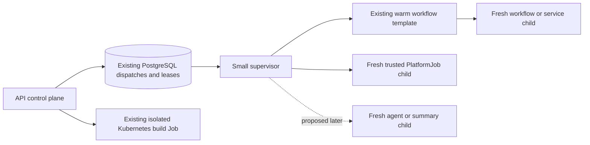

# Lean executor spike

This spike starts from `origin/main` at `7aa1ccea9`, after rebasing the
`codex/lean-runner-spike` worktree. It adds a diagnostic and a single live-job
fixture; it does not change the production executor or deployment settings.

## Design being tested

A container can have every job dependency installed without importing those
dependencies into its permanent Python process. The installed image determines
disk use. Live processes, shared library pages, file cache, and kernel accounting
determine resident memory.

Keep one small supervisor and the existing warm workflow template. Start trusted
platform handlers in fresh interpreters, and let them exit when their work ends.
Their Python heaps then disappear, including imports and allocator arenas that
Python might retain indefinitely in a reused process. Reclaimable file cache can
remain. Customer workflow code continues to fork from the restricted template;
trusted handlers must not inherit that customer-code execution environment.



The small supervisor would own claim transport, heartbeats, admission, process
lifecycle, cancellation, and drain. Payload validation, ORM models, build tools,
provider clients, and handler-specific services belong in the process that uses
them. Keep the existing durable records, lease tokens, retry rules, authorization,
notifications, and memory profiles; a smaller process does not justify a second
job framework.

## Measured result

Each of two catalog cycles kept one real workflow template alive while launching
50 probe children. The same parent ran both cycles; the template restarted
between them. In total: 92 definition probes, two provider-construction probes,
two allocation probes, four intentional failure/timeout probes, plus two
short-lived inventory helpers. All 92 definition comparisons matched the
canonical registry. No SQLAlchemy, FastAPI,
Pydantic AI, OpenAI, or Anthropic module entered the parent.

This container contains the diagnostic parent and workflow template; the local
SDK server and production claim/control loops are excluded. The
[raw measurements](2026-10-24-lean-runner-spike.json) retain every probe,
including failures, with the image/dependency identity and method.

| Measurement | Result |
| --- | ---: |
| Whole container after first mixed cycle, template still warm | 71.1 MiB working set |
| Whole container after second mixed cycle, template still warm | 71.8 MiB working set |
| Warm template alone, second cycle | 47.9 MiB PSS |
| Parent after second cycle | 15.7 MiB PSS / 22.4 MiB RSS |
| Whole container maximum working set sampled after child readiness | 255.8 MiB |
| Eager registry child, all definitions loaded | 136–150 MiB PSS |
| Direct definition child, depending on job | 21–127 MiB PSS |
| Agent/summary modules plus OpenAI and Anthropic model construction | 188 MiB PSS in the disposable child |

The permanent processes returned to roughly 71–72 MiB after the mixed work.
They did not retain the heavy child's heap. The small increase between cycles
includes accumulated diagnostic samples and cgroup accounting; this is two
cycles, not a long soak proving zero growth. Initial container accounting was
lower (about 63 MiB with the template), so use the post-work settled values.

The full eager registry took 2.4–6.6 seconds from process spawn to readiness;
the direct definition probes took 0.25–4.9 seconds. This is a shared host, with
other test/quality activity, so these times expose the size of the startup cost
without establishing a before/after latency result. Existing PlatformJob
children already pay fresh-interpreter imports today. Moving agents from the
parent to fresh interpreters would introduce a new cost for that family.

The following table is **definition import/construction only**, using the
median of two fresh children per type. A 22 MiB definition does not imply that
running a video, embedding, export, or backfill needs only 22 MiB. Handler-local
imports, payloads, subprocesses, and actual work are additional.

| Job type | Direct-import child PSS (MiB) | Spawn to ready (s) |
| --- | ---: | ---: |
| `agent.summary_backfill` | 22.3 | 0.55 |
| `application.deploy` | 123.2 | 3.43 |
| `application.publish` | 78.7 | 2.15 |
| `application.sdk_update` | 122.5 | 3.64 |
| `artifact.retention_cleanup` | 73.6 | 1.67 |
| `audit.archive` | 102.9 | 2.77 |
| `audit.query` | 102.7 | 2.68 |
| `chat.video_generation` | 22.2 | 0.45 |
| `embedding.reindex` | 21.6 | 0.38 |
| `files.move` | 22.0 | 0.44 |
| `model_catalog.refresh` | 73.8 | 1.44 |
| `oauth.refresh` | 73.8 | 1.82 |
| `run.retention` | 68.6 | 1.45 |
| `sdk.video_generation` | 22.2 | 0.42 |
| `solution.deploy` | 102.4 | 2.28 |
| `solution.export` | 21.6 | 0.28 |
| `solution.git_sync` | 58.2 | 1.58 |
| `solution.update_check` | 73.8 | 1.62 |
| `webhook.renew` | 73.9 | 1.66 |
| `workspace.bundle_import` | 126.1 | 3.57 |
| `workspace.file_index_reconcile` | 74.0 | 1.99 |
| `workspace.git` | 93.3 | 2.43 |
| `workspace.reimport` | 58.4 | 1.22 |

## What happens to the other work

| Work family | Current execution | Consequence for a slim design |
| --- | --- | --- |
| Workflows | Fresh child forked from the warm template | Retain the template; customer imports and payload memory belong to the execution child. |
| Services | Persistent execution child | A running service remains active memory for its lifetime. It cannot be counted as idle. |
| Local PlatformJobs, including maintenance, exports, git, reindex, video, deploys and builds | Existing fresh trusted child, same container cgroup | Keep this boundary. Remove registry/handler imports from the supervisor; active jobs still need their actual memory budget. |
| Agent runs | Async work inside the executor process | Would need a trusted child boundary to recover its imports after a run. This spike does not implement streaming, tools, cancellation, or recovery for that boundary. |
| Summaries and summary backfill dispatches | Async work inside the executor process | Same need for a child boundary. A backfill coordinator and each summary retain their existing durable ownership. |
| Isolated build-class PlatformJobs | Existing Kubernetes Job when enabled in Scaling & Isolation | Already a separate cgroup. Preserve durable backend selection and Job/pod UID fencing. |
| Package changes | Executor coordinates dependency installation/template recycle | Installation and package inspection can run in disposable helpers. Preserve generation fencing before replacing the template. |

All 23 current PlatformJob definitions are discovered from the canonical registry
by a short-lived helper. The parent does not import that registry. Two probes
then compare resolving a job through today's eager registry with importing its
definition module directly. Both use the same code-owned definition; neither
executes its handler. Direct import is a measurement of a possible boundary,
not an implemented lazy registry.

## Scope and limits

The harness keeps the real `TemplateProcess` alive while disposable children
load definitions, initialize agent/summary modules and synthetic provider
clients, allocate a controlled payload, fail, and time out. It records process
RSS/PSS and whole-cgroup `memory.current - inactive_file` before, during, and
after each child. These process values are not additive memory buckets.
Sampling begins at the post-import ready signal; import-time transient peaks
are not captured. The reported active maximum is neither a lifetime peak nor
a full-workload memory limit.

One separate E2E case enters the existing PlatformJob runner in a disposable
child and refreshes an expired synthetic OAuth token against the local fixture
server. It verifies durable success, progress, token refresh, lease clearing,
and refusal of a stale progress token. This is one real job, not a claim that
every handler has been executed. Its measurements share the pytest cgroup and
are not used as an idle-container benchmark.

The measured thin parent does **not** serve the worker's local SDK socket, claim
PostgreSQL work, heartbeat leases, install packages, handle notifications, or
manage Kubernetes. Consequently its idle result is a lower-bound experiment,
not a complete replacement worker or a safe production memory limit.

The local SDK socket is a separate, material design constraint. Keeping the
existing FastAPI/ORM-backed SDK implementation resident adds its real footprint.
Moving it to another permanent process in the same pod would not remove that
cost from the pod. Forwarding SDK requests to API containers would change load
and latency. This spike makes neither change and establishes no latency parity.

Fresh trusted children also pay import/client startup costs. Workflow fork
latency benefits from retaining the warm template; agents cannot assume the same
benefit. Do not promise unchanged first-response latency for agents until their
complete streaming/tool path has been measured. Keeping an agent process warm
is a valid tradeoff, but its RAM must remain in the idle budget.

## Reproduce

Use the worktree's source and locked API image in a fresh, otherwise empty
cgroup. The diagnostic requires Linux `/proc` and cgroup v2. The construction
matrix needs no credentials, database, provider requests, or network access.

```bash
docker run --rm --network none --memory 2g --user 1000 --entrypoint python \
  -v "$PWD/api/src:/app/src:ro" \
  -v "$PWD/api/shared:/app/shared:ro" \
  -v "$PWD/api/bifrost:/app/bifrost:ro" \
  -v "$PWD/api/scripts:/app/scripts:ro" \
  -e BIFROST_ENVIRONMENT=testing \
  -e BIFROST_SECRET_KEY=synthetic-spike-key-at-least-32-characters \
  bifrost-test-api-dev:bifrost-test-9fbb4532 \
  -m scripts.lean_runner_spike --cycles 2 --mode both --hold-seconds 0.1 \
  > /tmp/lean-runner-spike.json
```

`--job-type` can be repeated to restrict the catalog. Failure and timeout probes
are intentional and retained in the JSON. A failed normal probe is an invalid
measurement, not an excuse to omit the row.

The original matrix's first intentional timeout expired during interpreter
startup, so it proves readiness-failure cleanup rather than active-job timeout.
The second reached the active state and was killed correctly. The harness now
starts the intentional 200 ms execution deadline only after the ready/active
handshake, and the regression test requires an active sample. A follow-up run
of `oauth.refresh` and `application.deploy`, with both provider clients and the
allocation/failure/timeout stages, checks that corrected boundary across two
cycles. Raw results retain both runs rather than silently replacing the first.
Both corrected cycles reached active timeout and recovered; their final warm
container working sets were 70.95 and 70.94 MiB.

## Next implementation boundary

The useful next production candidate is narrowing permanent imports while
preserving the local SDK socket, then measuring the full idle executor after a
mixed workload. A genuinely tiny supervisor also needs a narrow control
transport and an explicit SDK routing decision. Those are separate choices from
whether an individual PlatformJob can run in a disposable child, which it
already does today.

Before switching agent/summary execution, prove requester identity, streaming,
tool delegation, cancellation, retry/recovery, drain, and memory admission
through their existing shared dispatch paths. Before lowering resource settings,
measure overlapping active work and persistent services. Idle RAM is not the
container's required memory limit.

## Verification

```bash
./test.sh tests/unit/test_lean_runner_spike.py \
  tests/unit/execution/test_template_import_boundary.py \
  tests/unit/jobs/test_platform_job_runner.py \
  tests/e2e/platform/test_lean_runner_spike.py -q --durations=0
./test.sh quality api
./test.sh tests/unit/test_lean_runner_spike.py -q --durations=0
```

Nine tests passed. After correcting the intentional timeout's phase boundary,
the five diagnostic unit tests passed again (6.69 seconds). The new live test
starts exactly one real job. Its call took
6.53 seconds, with 0.38 seconds of setup; it includes fresh runner imports and
the local OAuth operation. The catalog/definition unit case took 10.38 seconds
for its registry helper plus selected child. These are shared-host observations,
not latency guarantees. The complete backend, frontend, browser, and Kubernetes
suites were not run; this change modifies no production runtime path. API quality
checks passed with zero type errors/warnings and a clean Ruff result.
