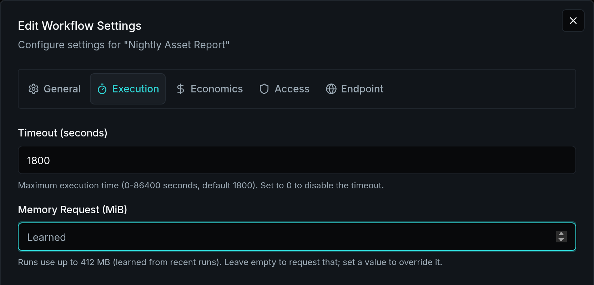
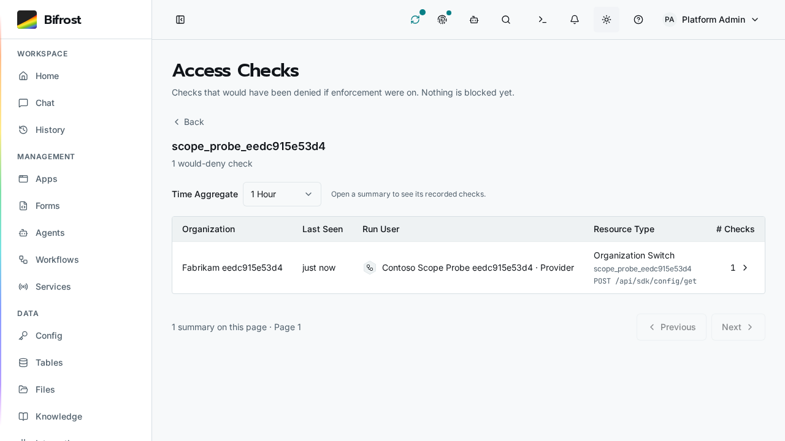
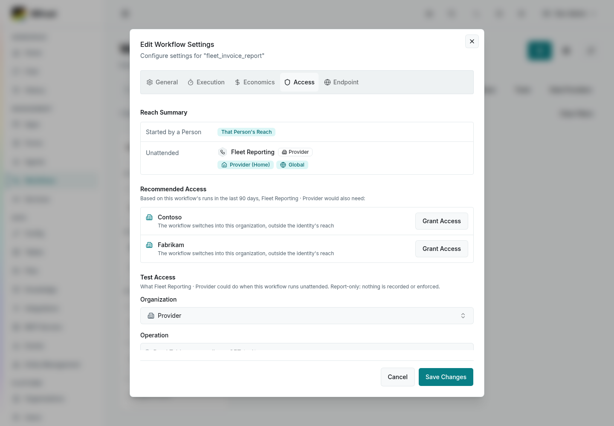
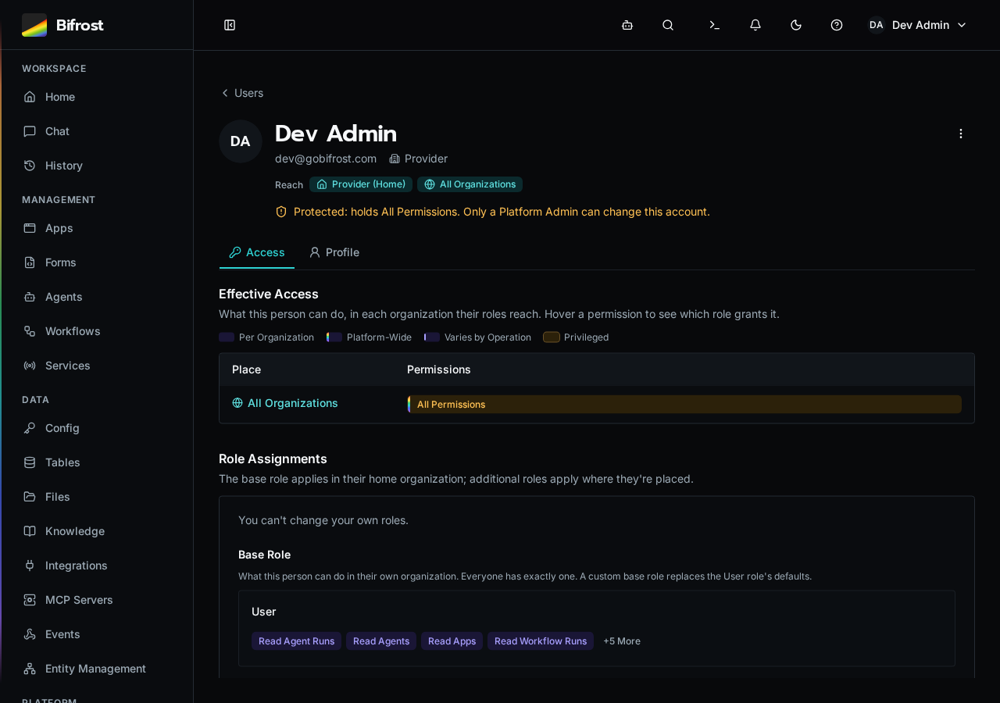
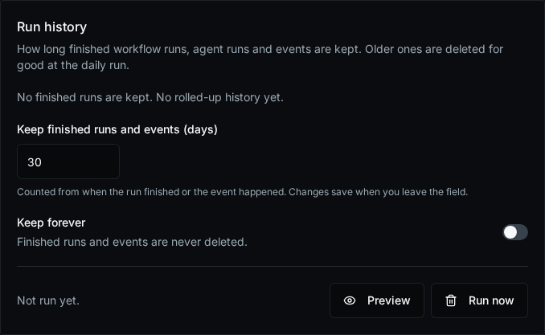

<!-- product-updates: base=ade714a08b95c84daa285e859ebece55f45c6754 target=10ff88c118a0c0522b35e9bfa8c04b0fe94480c1 content-ref=52651c3fe57173df5107b583deb60c5532ed995a -->

# Bifrost release notes

## Pinned Updates

### Bifrost 2.0: Upgrade Checklist and Highlights


Faster workflows, App SDK improvements, elastic workers, and clearer permissions.

**Recommended Steps**

1. Update images, then sign in again if prompted. Update the CLI and refresh MCP tools.
2. Review **App SDK Updates** (in Bifrost). Use eligible automatic updates (opt-in) or update manually so compatible SDK fixes arrive on reload. Confirm updates complete.
3. If builds lack memory, consider replacing the scheduler with resized workers. Solution deploys build locally; independent App deploys still build server-side.

Existing supported Apps need no rebuild to keep working. Read the details below and the [Upgrade Guide](https://github.com/gobifrost/bifrost/blob/10ff88c118a0c0522b35e9bfa8c04b0fe94480c1/docs/runbooks/stable-2-upgrade.md) for conditional checks and safe retirement.

#### Agent Prompt

Copy this prompt to have your coding agent help you with this change.

<details>
<summary>Show Prompt</summary>

```text
You are helping me review a Bifrost 2.0 upgrade and bring deployed Apps onto the current SDK. You can reach deployment configuration, an API-matched CLI, App or Solution source where available, and a shell. Inspect current versions, App SDK status, retained-source eligibility, automatic-update settings and queued or failed builds. Report scheduler and worker memory limits and available headroom. Distinguish Solution deployment, which prebuilds Apps locally, from independent App deployment, which builds on the server. Propose the applicable SDK updates or source redeploys and any worker resizing or scheduler retirement, and wait for my confirmation. Preserve active deployments, databases, secrets and pending work; verify replacement capacity before removing the scheduler. After approved changes, confirm App SDK jobs completed, existing Apps receive live updates and representative workflows succeed. Existing supported Apps do not require a rebuild to survive the image upgrade. Do not enable automatic updates, alter infrastructure or reconcile unrelated Solution entities without the approved plan.
```

</details>

Sources: [#1279](https://github.com/gobifrost/bifrost/pull/1279), [#1158](https://github.com/gobifrost/bifrost/pull/1158), [#1039](https://github.com/gobifrost/bifrost/pull/1039), [#1209](https://github.com/gobifrost/bifrost/pull/1209), [#1264](https://github.com/gobifrost/bifrost/pull/1264), [#1283](https://github.com/gobifrost/bifrost/pull/1283)

## Security

### Protect Workspace and Build Boundaries

Editor deletion rejects empty and ambiguous paths before storage access. Solution policy caches keep installation scopes separate, and deploy archives reject symlinks. Development containers start as the unprivileged user. Build tooling verifies package integrity; Python and certificate maintenance reject compromised trust paths while preserving configured private certificate authorities.

Sources: [#929](https://github.com/gobifrost/bifrost/pull/929), [#1212](https://github.com/gobifrost/bifrost/pull/1212), [#1213](https://github.com/gobifrost/bifrost/pull/1213), [#1235](https://github.com/gobifrost/bifrost/pull/1235), [#1258](https://github.com/gobifrost/bifrost/pull/1258)

Credits: [MTG-Thomas](https://github.com/MTG-Thomas) (#1212), [MTG-Thomas](https://github.com/MTG-Thomas) (#1213), [MTG-Thomas](https://github.com/MTG-Thomas) (#1235)

### Update Dependencies With Reviewed Security Fixes

Security updates cover the MCP and AI libraries, HTML sanitization, and supporting build and test packages. The fixed-CVE list distinguishes runtime dependencies from development tooling. A moderate minimatch advisory remains open in development-only tooling; it is absent from the client production dependency tree.

Sources: [#920](https://github.com/gobifrost/bifrost/pull/920), [#921](https://github.com/gobifrost/bifrost/pull/921), [#924](https://github.com/gobifrost/bifrost/pull/924), [#1051](https://github.com/gobifrost/bifrost/pull/1051), [#1071](https://github.com/gobifrost/bifrost/pull/1071), [#1072](https://github.com/gobifrost/bifrost/pull/1072), [#1135](https://github.com/gobifrost/bifrost/pull/1135), [#1136](https://github.com/gobifrost/bifrost/pull/1136)

### Protect Runtime Credentials and Consent

Workflow and service logs mask credential-bearing headers and prevent log-message injection. Run provenance comes from durable records, and OAuth refreshes retain organization scope. Worker-control connections isolate credentials; Bot Framework verification limits unknown-key refresh traffic. Native MCP sign-in requires explicit app consent bound to the human session and callback.

Sources: [#925](https://github.com/gobifrost/bifrost/pull/925), [#1023](https://github.com/gobifrost/bifrost/pull/1023), [#1064](https://github.com/gobifrost/bifrost/pull/1064), [#1065](https://github.com/gobifrost/bifrost/pull/1065), [#1214](https://github.com/gobifrost/bifrost/pull/1214), [#1215](https://github.com/gobifrost/bifrost/pull/1215), [#1237](https://github.com/gobifrost/bifrost/pull/1237), [#1259](https://github.com/gobifrost/bifrost/pull/1259)

Credits: [MTG-Thomas](https://github.com/MTG-Thomas) (#1214), [MTG-Thomas](https://github.com/MTG-Thomas) (#1215)

### Verify SSO Provider Tokens

SSO sign-in now verifies provider tokens and binds them to the original sign-in request. Existing account links are preserved. Operators of generic OIDC providers that previously returned only user information must configure a valid ID-token response before upgrading; those providers can no longer complete sign-in without it.

#### Agent Prompt

Copy this prompt to have your coding agent help you with this change.

<details>
<summary>Show Prompt</summary>

```text
You are helping me verify a generic OIDC provider before upgrading Bifrost. You can reach my Bifrost SSO configuration and the provider application settings and documentation. Inspect whether the provider returns a signed ID token for the requested OpenID Connect flow and whether issuer, audience, subject and nonce validation match the application. Identify any provider that previously returned only user information. Propose the exact configuration change and a controlled test-account sign-in, and wait for my confirmation. Apply only approved changes and verify that the existing account link is retained. Keep signature and identity validation enabled. Never print client secrets, private keys or tokens, and stop if the observed provider contract differs from the plan.
```

</details>

Sources: [#1265](https://github.com/gobifrost/bifrost/pull/1265)

Credits: [MTG-Thomas](https://github.com/MTG-Thomas) (#1265)

### Confirm Unattended File Sync

Unattended sync, pull, directory mirror pushes and initial watch sync now require `--force` or `BIFROST_NONINTERACTIVE=1`. Existing aliases, conflict selection and deletion rules are preserved.

#### Agent Prompt

Copy this prompt to have your coding agent help you with this change.

<details>
<summary>Show Prompt</summary>

```text
You are helping me update unattended Bifrost file synchronization for explicit conflict consent. You can reach my synchronization scripts, CI configuration, workspace configuration, and a shell with the API-matched CLI. Inspect uses of sync, pull, directory mirror pushes, and initial watch synchronization. Identify which noninteractive invocations need the force flag or the BIFROST_NONINTERACTIVE setting. Preserve their existing conflict selection and deletion rules. Propose the exact edits and how to verify them on an isolated workspace, and wait for my confirmation. Apply only approved edits, verify the intended files and conflicts, and stop if a command would affect unexpected data. Do not broadly enable noninteractive consent for unrelated jobs.
```

</details>

Sources: [#1257](https://github.com/gobifrost/bifrost/pull/1257)

### Verify Email Ownership Before SSO Account Linking


New Microsoft SSO links use work-account sign-in names instead of editable mail attributes. Google SSO links require Gmail or a verified Workspace address, including secondary domains. Existing linked accounts continue to sign in by provider ID.

**Review Authentication Settings** (in Bifrost)

Sources: [#1130](https://github.com/gobifrost/bifrost/pull/1130)

Credits: [shaank0](https://github.com/shaank0) (#1130)

### Scope Role Edits and Notification Access


Changing privileged role permissions requires Read and Write Privileged Access. Administrators can read and dismiss admin notifications while personal notifications stay with their owner.

**Open Roles** (in Bifrost)

Sources: [#995](https://github.com/gobifrost/bifrost/pull/995)

### Integration Credential Handling


Integration credentials and webhook signing secrets have tighter access controls.

Signing secrets are shown when created or rotated. Webhook deliveries omit clientState, and runtime secrets are available through the authorized workflow SDK.

Sources: [#845](https://github.com/gobifrost/bifrost/pull/845), [#870](https://github.com/gobifrost/bifrost/pull/870), [#871](https://github.com/gobifrost/bifrost/pull/871), [#874](https://github.com/gobifrost/bifrost/pull/874)

### Stricter Data and Execution Access

Table updates check permissions before and after changes. Agent artifacts and WebSocket channels enforce caller scope; app embeds stay within app endpoints. Runtime secrets are available through authorized workflow SDK calls.

Sources: [#791](https://github.com/gobifrost/bifrost/pull/791), [#813](https://github.com/gobifrost/bifrost/pull/813), [#814](https://github.com/gobifrost/bifrost/pull/814), [#815](https://github.com/gobifrost/bifrost/pull/815), [#817](https://github.com/gobifrost/bifrost/pull/817)

### Dependency Security Updates


Updated pydantic-ai to 2.53.0, which patches [GHSA-6fqq-452j-qhrp](https://github.com/pydantic/pydantic-ai/security/advisories/GHSA-6fqq-452j-qhrp). No affected wrappers were found in platform code. The docs-tooling js-yaml update bounds YAML merge CPU use. The SimpleWebAuthn browser update does not change an affected server package.

Sources: [#718](https://github.com/gobifrost/bifrost/pull/718), [#910](https://github.com/gobifrost/bifrost/pull/910), [#714](https://github.com/gobifrost/bifrost/pull/714)

## Action Required

### Faster SDK Workflows


SDK workflows now reuse cached config values and database connections, reducing repeated work without new settings. The default API connection ceiling remains unchanged; each API process can retain ten more idle connections after a burst. Concurrent first writes now create one table. Installations with duplicate ad-hoc table names in one organization or global scope must resolve them before upgrading. The migration reports affected table IDs and stops without changing data. **Review Tables** (in Bifrost)

#### Agent Prompt

Copy this prompt to have your coding agent help you with this change.

<details>
<summary>Show Prompt</summary>

```text
You are helping me prepare a Bifrost upgrade that restores missing unique indexes for ad-hoc tables. You can reach my Bifrost deployment files, backup process, migration logs, and a read-only database connection. Inspect the migration named 20261101_table_name_unique. Use a read-only query to find duplicate names among tables where solution_id IS NULL, grouping by organization_id and name. Report each affected scope and table ID without printing connection strings or secrets. If duplicates exist, inspect their documents and references, confirm a current backup, propose the exact resolution, and wait for my confirmation before changing any data. Never discard documents or automatically delete or rename tables. Apply only an explicitly approved resolution, then verify the duplicate check is clear. Run the upgrade only if I approved it; the migration repeats its check under a table lock. Stop if anything differs from the approved plan.
```

</details>

Sources: [#1180](https://github.com/gobifrost/bifrost/pull/1180)

### Scale Background Work Across External Workers


Run workflows, agent runs, summaries, platform jobs, and services on externally managed workers. Installations with older physical launchers must upgrade them before enabling this version so live summaries and summary backfills can run; the API no longer executes summaries. Configure scaling in **Workers Settings** (in Bifrost).

#### Agent Prompt

Copy this prompt to have your coding agent help you with this change.

<details>
<summary>Show Prompt</summary>

```text
You are helping me configure external worker capacity and upgrade physical launchers for remote summaries. You can reach my Bifrost deployment configuration, infrastructure repository and a shell. Inspect the installed API and launcher versions, provider configuration and deployment procedure. Explain which launchers need upgrading, the pinned image and rollback plan, and wait for my confirmation. Apply only the confirmed changes through the existing deployment procedure. Verify worker admission, a workflow, a live summary and a summary backfill. Preserve PostgreSQL coordination, TLS verification, credentials and unrelated infrastructure. Stop if the target or provider differs from the approved plan.
```

</details>

Sources: [#1172](https://github.com/gobifrost/bifrost/pull/1172)

Credits: [MTG-Thomas](https://github.com/MTG-Thomas) (#1172)

### Sign In Again After the Upgrade

After updating the images, people may need to sign in again in browsers, the CLI and MCP clients. Passwords, MFA enrollments and passkeys are retained. Existing supported Apps keep working without an SDK rebuild. Use the [2.0 Upgrade Guide](https://github.com/gobifrost/bifrost/blob/e7c95328aa87bc3a9313ca05c694b5e8c02f0a4a/docs/runbooks/stable-2-upgrade.md) for deployment and multi-replica cutover guidance. Keep the new authentication validator when applying a repair build.

#### Agent Prompt

Copy this prompt to have your coding agent help you with this change.

<details>
<summary>Show Prompt</summary>

```text
You are helping me update Bifrost to 2.0.
You can reach my deployment files and a shell with access to the installation.
1. Inspect the installed version, API replicas, backups and deployed image identities. Read the current 2.0 Upgrade Guide and report the normal image update and any applicable multi-replica cutover boundary. Preserve PostgreSQL, object storage, the platform secret and pending broker work.
2. Propose the exact image update and verification plan, and wait for my confirmation. Existing supported SDK2 Apps do not need a rebuild. Scheduler retirement and worker expansion are optional. People may need to sign in again; separately installed CLI clients must meet the API minimum version.
3. After confirmation, apply the plan and verify every serving API uses the selected build, human login and refresh work, a normal workflow succeeds and an existing App receives live updates.
Do not change anything unrelated, and stop if the installation does not match the plan.
```

</details>

Sources: [#1149](https://github.com/gobifrost/bifrost/pull/1149), [#1276](https://github.com/gobifrost/bifrost/pull/1276), [#1277](https://github.com/gobifrost/bifrost/pull/1277), [#1279](https://github.com/gobifrost/bifrost/pull/1279)

### Update the CLI and MCP Clients

**CLI/SDK users:** install the API-matched CLI with the platform upgrade. Versions through 1.4.1 cannot parse the new execution response. Refresh external MCP clients for the renamed `bifrost_<noun>_<verb>` tools. The interactive local runner is removed; direct workflow runs remain.

**Open MCP Settings** (in Bifrost)

#### Agent Prompt

Copy this prompt to have your coding agent help you with this change.

<details>
<summary>Show Prompt</summary>

```text
You are helping me update Bifrost CLI, SDK-facing tooling and external MCP clients for the platform upgrade. You can reach my local CLI installation, connected Bifrost API, development workspace and MCP client configuration. Inspect installed versions and tool names, identify incompatible callers, and propose an API-matched CLI update and MCP configuration changes. Show the exact commands and affected clients, and wait for my confirmation. Apply only approved changes. Verify the installed CLI version, a normal read, an isolated workflow execution response and the renamed MCP tools. Preserve authentication boundaries and existing credentials; never print secret values. Stop if the API or workspace differs from the plan.
```

</details>

Sources: [#820](https://github.com/gobifrost/bifrost/pull/820), [#830](https://github.com/gobifrost/bifrost/pull/830), [#831](https://github.com/gobifrost/bifrost/pull/831), [#833](https://github.com/gobifrost/bifrost/pull/833), [#834](https://github.com/gobifrost/bifrost/pull/834), [#835](https://github.com/gobifrost/bifrost/pull/835)

## What's New

### Keep Sessions and Conversion Reviews


Role and bulk-user updates wait for access refresh before reporting success, so reloading keeps the session. Workflow conversion reviews stay visible when completion notifications refresh their reports, preserving the mobile sheet's return focus.

Sources: [#1266](https://github.com/gobifrost/bifrost/pull/1266)

### Choose Default Roles and Chat Access


New users and custom identities can start with your instance default base role or an organization override. Update existing accounts in bulk, and control Use Chat separately from AI and agent execution. User keeps Chat access by default.

**Open Base Role Defaults** (in Bifrost)

Sources: [#1264](https://github.com/gobifrost/bifrost/pull/1264)

### Customize Agent Plugin Branding


Add package name and logo controls in Settings → MCP. Generated packages use the configured name and normalized logo. Refs #640.

Sources: [#1251](https://github.com/gobifrost/bifrost/pull/1251)

### Run in Organization


Choose an organization before running a workflow or submitting a form. Bifrost uses that organization's data and integrations within your existing permissions.

**Open Workflows** (in Bifrost) · **Open Forms** (in Bifrost)

Sources: [#1244](https://github.com/gobifrost/bifrost/pull/1244)

### Faster Workflow Starts


Workflows start sooner when many runs are queued. Queue-position updates are combined so they no longer hold up execution, while live status and completion updates continue normally.

Sources: [#1209](https://github.com/gobifrost/bifrost/pull/1209)

### Edit Inputs Before Rerunning


Rerun now opens the standard workflow fields with the previous execution’s inputs filled in. Review or change them before starting a new execution. Structured inputs use the JSON code editor.

**Open History** (in Bifrost)

Sources: [#1171](https://github.com/gobifrost/bifrost/pull/1171)

### Daily Installation Usage Reporting


Bifrost sends anonymous daily usage reports by default, containing only:

- Persistent random installation ID
- Bifrost version
- UTC date
- Workflow run count
- Agent run count
- Format version
- Production marker

Our reporting service retains no IP addresses or request metadata. Development, testing, and debug instances are excluded. Set `BIFROST_USAGE_REPORTING_ENABLED=false` to permanently opt out.

Sources: [#1163](https://github.com/gobifrost/bifrost/pull/1163)

### SDK Updates Without App Rebuilds


Update an existing App’s SDK once to switch to server delivery. After that, compatible SDK fixes arrive on reload without rebuilding the App or redeploying its Solution.

**Open Apps** (in Bifrost)

Sources: [#1158](https://github.com/gobifrost/bifrost/pull/1158)

### Automatic App SDK Upgrades


Automatically rebuild apps for reviewed SDK updates that need no code changes, with progress in Notifications. Enable App SDK Upgrades in Maintenance; it starts off during initial testing, and failures leave the current deployment active for a manual retry.

**Open Maintenance** (in Bifrost)

Sources: [#1153](https://github.com/gobifrost/bifrost/pull/1153)

### React to Successful Workflows


Subscribe to `workflow.completed` to run follow-up automation after a workflow succeeds. Events carry metadata; fetch results through the execution API with your existing permissions.

**Open Events** (in Bifrost)

Sources: [#1100](https://github.com/gobifrost/bifrost/pull/1100)

### Scaling and Isolation Move to Settings


On Kubernetes, worker scaling and build isolation are now set in Settings → Kubernetes → Scaling & Isolation, and changes apply without a restart. On first start, Bifrost copies your current environment values there and lists the variables you can then remove. Isolated builds also get a larger pod when they need more memory.

**Open Scaling & Isolation** (in Bifrost)

#### Agent Prompt

Copy this prompt to have your coding agent help you with this change.

<details>
<summary>Show Prompt</summary>

```text
You are helping me clean up my Bifrost Kubernetes deployment after scaling and isolation moved to Settings.
You can reach my Bifrost Kubernetes manifests or GitOps repository and kubectl access to the Bifrost namespace.
1. Ask me whether I may still roll back to the previous Bifrost release. If I may, stop.
2. Read the API startup log for the warnings that name environment variables no longer read or to be renamed, and check that Settings → Kubernetes → Scaling & Isolation lists the same variables.
3. Find where each of them is set in my manifests (ConfigMaps, Secrets, Deployment env).
4. Propose the exact changes and wait for my confirmation: remove each variable that is no longer read, and rename each BIFROST_KUBERNETES_BUILD_ variable that is still read to its BIFROST_KUBERNETES_JOB_ name, or remove it if it only repeats what the API pod already uses.
5. Apply them, roll out the API, then verify that the startup log has no such warnings, the Settings notice is empty, and a test workflow run succeeds.
Do not change anything unrelated, and stop if anything does not match what you expect.
```

</details>

Sources: [#1061](https://github.com/gobifrost/bifrost/pull/1061)

### Recommended: Upgrade to the Unified Worker


The scheduler and worker share one executor; an unchanged scheduler still works as a second worker. We recommend 2 GB per worker; larger App builds may need more. Establish healthy replacement workers before retiring scheduler capacity. Retire RabbitMQ and KEDA only after every queue and unacknowledged message is accounted for.

[Sizing Guide](https://github.com/gobifrost/bifrost/blob/main/docs/runbooks/kubernetes-worker-deployment.md#resource-sizing)

#### Agent Prompt

Copy this prompt to have your coding agent help you with this change.

<details>
<summary>Show Prompt</summary>

```text
You are helping me upgrade my Bifrost install to the unified worker runtime.
You can reach my Bifrost deployment files (docker-compose.yml or Kubernetes manifests) and a shell with docker or kubectl access to it.
1. Find how Bifrost is deployed and report what applies:
   - the scheduler and worker services or Deployments, with their replicas and memory limits;
   - any rabbitmq service or Deployment, and any KEDA ScaledObject or TriggerAuthentication for Bifrost;
   - these retired environment variables, if set: BIFROST_RABBITMQ_URL, BIFROST_MAX_CONCURRENCY, BIFROST_MAX_WORKERS, BIFROST_MAX_SERVICE_WORKERS.
   - Also list any variable that the API's startup log names as no longer read.
2. If RabbitMQ is still running, check the API logs for "Drained work queued by an earlier release". Treat that log as a starting point: inspect every broker queue, including poison messages, and all unacknowledged work. If any work is unexplained or not safely recovered, stop; do not delete or replay it.
3. Inspect App SDK update/build status and worker memory headroom. Propose replacement worker capacity before retiring the scheduler, and wait for my confirmation:
   - Docker Compose: one worker service with 2 replicas and a 2 GB memory limit each, as in the current Bifrost docker-compose.yml; remove the scheduler and rabbitmq services; then run docker compose up -d --remove-orphans.
   - Kubernetes: apply the new base manifests; once the bifrost-worker and bifrost-scheduler pods are gone, delete those Deployments; delete the rabbitmq Deployment and Service and any Bifrost KEDA ScaledObject and TriggerAuthentication.
   - Remove the retired environment variables listed above.
4. Establish healthy replacement capacity first, then apply the confirmed retirement changes. Verify that the API's /health/ready check passes, a workflow succeeds, and App SDK update jobs finish successfully. Larger App builds may need more than the recommended 2 GB per worker.
Do not change anything unrelated, and stop if anything does not match what you expect.
```

</details>

Sources: [#1039](https://github.com/gobifrost/bifrost/pull/1039), [#1040](https://github.com/gobifrost/bifrost/pull/1040), [#1041](https://github.com/gobifrost/bifrost/pull/1041), [#1055](https://github.com/gobifrost/bifrost/pull/1055)

### Workers Scale on Demand in Kubernetes


On Kubernetes, the API starts worker Jobs as work arrives and drains them when idle, keeping one warm for instant runs and up to six by default. After an upgrade, workers on the old build are replaced once a new one is ready, and their runs finish first. Set the range in Settings → Kubernetes.

**Open Diagnostics** (in Bifrost)

Sources: [#1033](https://github.com/gobifrost/bifrost/pull/1033), [#1039](https://github.com/gobifrost/bifrost/pull/1039), [#1054](https://github.com/gobifrost/bifrost/pull/1054)

### Workflows Run by Memory, Not Slots


Workers now take work by memory, not fixed slots. Each workflow learns its memory use, or set a Memory Request in its settings. A run too large for a standard worker gets a larger one on Kubernetes; work no worker can hold fails at once. Max worker and concurrency settings are now ignored.

**Open Workflows** (in Bifrost)



A workflow requests the memory its recent runs used, unless you set one.

Sources: [#1044](https://github.com/gobifrost/bifrost/pull/1044)

### Automatic Agent Execution


Automatic mode for agents coordinates chat and background jobs in one conversation using approved specialist tools and optional subagents; [CodeMode](https://blog.cloudflare.com/code-mode-mcp/) batches calls and filters intermediate results. Our testing showed 41% lower recorded cost and 54% lower median runtime versus earlier Automatic; Delegated remains the default.

**Enable Automatic in AI Behavior Settings** (in Bifrost)

Sources: [#1024](https://github.com/gobifrost/bifrost/pull/1024), [#1046](https://github.com/gobifrost/bifrost/pull/1046), [#1056](https://github.com/gobifrost/bifrost/pull/1056)

### Move Files in a Location


Workflows can now move files within a location, such as a Solution's `docs`, with `files.move`, or up to 500 at a time with `files.move_many`. Files are copied on the server, keep their metadata, and pick up access from their new path. The CLI adds `bifrost files move`.

Sources: [#1022](https://github.com/gobifrost/bifrost/pull/1022)

Credits: [mlspivey](https://github.com/mlspivey) (#1022)

### Impersonate a User


Privileged users can select **Impersonate** on a user's profile to work in their session across browser tabs. A banner identifies the active session and provides **Exit**. Audit records retain the original operator's identity.

**Open Users** (in Bifrost)

Sources: [#1012](https://github.com/gobifrost/bifrost/pull/1012)

### Convert workflows to Declared Permissions


Review proposed permissions for individual workflows or a larger selection, then apply the changes you approve. Existing run identities and organization reach are preserved. Analysis follows imported Python helpers and saves a report you can reopen; changing the platform default remains a separate final step.

**Review workflow access** (in Bifrost)

Sources: [#1000](https://github.com/gobifrost/bifrost/pull/1000)

### Zero Trust Automation Checks Roles and Reach

Zero Trust Automation checks each run against the run user's roles and organization reach; Full Access adds every permission within that reach, while Declared Permissions adds configured permissions. Existing Full Access workflows retain their mode, and only new or changed Solution permission requests need approval.

**Open Access Checks** (in Bifrost)

Sources: [#996](https://github.com/gobifrost/bifrost/pull/996), [#998](https://github.com/gobifrost/bifrost/pull/998), [#1276](https://github.com/gobifrost/bifrost/pull/1276)

### Review Access Checks in One Place


Switch between Activity and Access Checks on the Auditing page. Group checks by time, then open a summary to inspect individual records and compare Then with Now. New installs retain audits for one year, including 30 days in the database.

**Open Access Checks** (in Bifrost)



Sources: [#994](https://github.com/gobifrost/bifrost/pull/994)

### Run Agents as Another User


Agents can now run as another user from the SDK with `run_as`, like workflows. Both need Impersonate Users in that user's organization instead of Platform Admin, and Platform Admins keep it. Run As shows on the agent run, and Access Checks records each impersonation.

**Open Roles** (in Bifrost) · **Open Access Checks** (in Bifrost)

Sources: [#968](https://github.com/gobifrost/bifrost/pull/968)

### Named Permissions in Access Checks

Inspect named platform permissions in Roles and review authorization records in Access Checks.

**Open Access Checks** (in Bifrost) · **Open Roles** (in Bifrost)

Sources: [#967](https://github.com/gobifrost/bifrost/pull/967)

### Manage the Identities Workflows Run As

Choose the identity a workflow runs as when no one starts it. Use past runs to recommend access, inspect effective permissions, and review Access Checks.

**Open Identities** (in Bifrost) · **Open Access Checks** (in Bifrost)



Recommended Access lists what the workflow's identity would also need, from its recorded runs.

Sources: [#942](https://github.com/gobifrost/bifrost/pull/942)

### Release Notes and Discord


Product release notes are now available in the app.

**Open Release Notes** (in Bifrost) · [Join Discord](https://discord.gg/x84pft2YDa)

Sources: [#918](https://github.com/gobifrost/bifrost/pull/918)

### See a User's Effective Access

See a user's effective access, role assignments, and organization scope.

**Open Users** (in Bifrost) · **Open Roles** (in Bifrost)



A user's effective permissions and organization scope.

Sources: [#879](https://github.com/gobifrost/bifrost/pull/879), [#889](https://github.com/gobifrost/bifrost/pull/889), [#890](https://github.com/gobifrost/bifrost/pull/890), [#895](https://github.com/gobifrost/bifrost/pull/895), [#900](https://github.com/gobifrost/bifrost/pull/900), [#903](https://github.com/gobifrost/bifrost/pull/903), [#914](https://github.com/gobifrost/bifrost/pull/914), [#915](https://github.com/gobifrost/bifrost/pull/915)

### More Reliable Agent Runs


Agent runs handle context limits, failover, timeouts, and interrupted specialists more reliably.

Sources: [#783](https://github.com/gobifrost/bifrost/pull/783), [#785](https://github.com/gobifrost/bifrost/pull/785), [#796](https://github.com/gobifrost/bifrost/pull/796), [#801](https://github.com/gobifrost/bifrost/pull/801), [#849](https://github.com/gobifrost/bifrost/pull/849), [#863](https://github.com/gobifrost/bifrost/pull/863), [#904](https://github.com/gobifrost/bifrost/pull/904), [#916](https://github.com/gobifrost/bifrost/pull/916)

Credits: [sdc53](https://github.com/sdc53) (#801)

### Run Workflow Services


Run long-lived listeners as supervised services. Start, stop, or restart them and inspect attempts and live logs.

**Open Services** (in Bifrost)

Sources: [#788](https://github.com/gobifrost/bifrost/pull/788), [#789](https://github.com/gobifrost/bifrost/pull/789), [#812](https://github.com/gobifrost/bifrost/pull/812)

### Restore Complete Solution Backups


Solution backups restore file inventories and table documents correctly, including large encrypted archives.

Sources: [#878](https://github.com/gobifrost/bifrost/pull/878), [#880](https://github.com/gobifrost/bifrost/pull/880), [#881](https://github.com/gobifrost/bifrost/pull/881), [#882](https://github.com/gobifrost/bifrost/pull/882), [#899](https://github.com/gobifrost/bifrost/pull/899), [#901](https://github.com/gobifrost/bifrost/pull/901), [#902](https://github.com/gobifrost/bifrost/pull/902), [#907](https://github.com/gobifrost/bifrost/pull/907)

### Safer Sync and Reimport


Sync protects Solution-owned resources and reports missing source instead of deleting entities.

Fetch changes made in Bifrost before Commit, Sync, or Discard; review deletions through git sync.

**Open GitHub Settings** (in Bifrost)

Sources: [#864](https://github.com/gobifrost/bifrost/pull/864), [#867](https://github.com/gobifrost/bifrost/pull/867), [#868](https://github.com/gobifrost/bifrost/pull/868), [#875](https://github.com/gobifrost/bifrost/pull/875), [#891](https://github.com/gobifrost/bifrost/pull/891)

### Compare Workflow Resource Use


Compare workflows by CPU, memory, duration, and AI usage. Older runs without telemetry show blank resource values.

**Open Usage** (in Bifrost)

Sources: [#803](https://github.com/gobifrost/bifrost/pull/803)

### Use Identity and Branding in Apps


The app SDK adds user, role, branding, and organization helpers, plus responsive navigation. Update the SDK or redeploy existing apps to use them.

**Open Apps** (in Bifrost)

Sources: [#894](https://github.com/gobifrost/bifrost/pull/894), [#896](https://github.com/gobifrost/bifrost/pull/896), [#897](https://github.com/gobifrost/bifrost/pull/897), [#898](https://github.com/gobifrost/bifrost/pull/898), [#906](https://github.com/gobifrost/bifrost/pull/906), [#913](https://github.com/gobifrost/bifrost/pull/913)

### Run App Builds in Kubernetes


Run app deploys and SDK rebuilds in isolated Kubernetes pods with memory limits. Requires the compatible Kubernetes builds overlay and execution policy; existing installs keep local execution.

**Open Execution Settings** (in Bifrost)

Sources: [#781](https://github.com/gobifrost/bifrost/pull/781)

### Review Workspace Imports


Choose entities and source from a Solution ZIP or repository snapshot before importing. Review collisions and unchanged items before applying changes.

**Open Solutions** (in Bifrost)

Sources: [#792](https://github.com/gobifrost/bifrost/pull/792)

### Test Model Connections


Test an AI profile with a real model request before using it in an agent.

**Open AI Settings** (in Bifrost)

Sources: [#807](https://github.com/gobifrost/bifrost/pull/807), [#809](https://github.com/gobifrost/bifrost/pull/809), [#850](https://github.com/gobifrost/bifrost/pull/850), [#853](https://github.com/gobifrost/bifrost/pull/853), [#855](https://github.com/gobifrost/bifrost/pull/855), [#861](https://github.com/gobifrost/bifrost/pull/861)

Credits: [wilhil](https://github.com/wilhil) (#807)

### Set History Retention

Choose how long to keep completed runs, events, and audit records. Run and event history defaults to 30 days, including existing installs. Choose **Keep Forever** to retain older runs; deleted run details are not archived. Existing audit policies are preserved. New installs keep audits for 30 days in the database and 365 days in the archive.

**Open Maintenance** (in Bifrost)



Choose a retention period or keep finished runs and events indefinitely.

Sources: [#905](https://github.com/gobifrost/bifrost/pull/905), [#908](https://github.com/gobifrost/bifrost/pull/908), [#994](https://github.com/gobifrost/bifrost/pull/994)

### Search Workspace and Solution Source


Search workspace files and retained Solution source together. Solution results are read-only.

**Open Files** (in Bifrost)

Sources: [#873](https://github.com/gobifrost/bifrost/pull/873)

## Other changes

- [Agent runs and chat messages run in separate worker processes, so a busy or memory-full API no longer delays or blocks them.](https://github.com/gobifrost/bifrost/pull/1103)
- [Agent runs and chat messages start immediately again, without waiting for the worker to load the agent runtime.](https://github.com/gobifrost/bifrost/pull/1106)
- [Allow Solution apps to update runtime files and validate file locations with the standalone CLI.](https://github.com/gobifrost/bifrost/pull/1222)
- [App build memory failures now explain the cause and give local-build or container-memory recovery guidance.](https://github.com/gobifrost/bifrost/pull/1074)
- [App lists and Integration controls now reflect the access already enforced when opening or updating a resource. Home organization names display consistently.](https://github.com/gobifrost/bifrost/pull/1017)
- [App SDK updates no longer fail on npm lockfile metadata or unrelated Solution entity definitions.](https://github.com/gobifrost/bifrost/pull/1155)
- [Apply custom logos consistently across Solutions, forms, and integrations.](https://github.com/gobifrost/bifrost/pull/856)
- [Apply organization permissions to live table subscriptions.](https://github.com/gobifrost/bifrost/pull/888)
- [Apps receive workflow completion before follow-up bookkeeping.](https://github.com/gobifrost/bifrost/pull/1151)
- [Audit failed sign-ins.](https://github.com/gobifrost/bifrost/pull/892)
- [Audit permission-rule changes.](https://github.com/gobifrost/bifrost/pull/885)
- [Avoid duplicate sign-in redirects when a session expires.](https://github.com/gobifrost/bifrost/pull/764) — [MTG-Thomas](https://github.com/MTG-Thomas)
- [Chat restoration errors no longer mark accepted runs failed.](https://github.com/gobifrost/bifrost/pull/1179) — [MTG-Thomas](https://github.com/MTG-Thomas)
- [Chat shows current context usage and cached input beside the model selector.](https://github.com/gobifrost/bifrost/pull/987)
- [CLI browser login keeps waiting through temporary throttling and stops when its device code expires.](https://github.com/gobifrost/bifrost/pull/971)
- [CLI sign-in fills in your device code and asks you to confirm the account and access before connecting.](https://github.com/gobifrost/bifrost/pull/1094)
- [CLI workflow execution exits correctly when a run finishes before log streaming connects.](https://github.com/gobifrost/bifrost/pull/972)
- [Concurrent synchronous workflow calls no longer hold database connections while waiting for execution results.](https://github.com/gobifrost/bifrost/pull/1093)
- [Concurrent table-document merges preserve changes to different fields instead of silently overwriting an earlier writer.](https://github.com/gobifrost/bifrost/pull/1115)
- [Dashboard charts keep working after opening and closing the code editor.](https://github.com/gobifrost/bifrost/pull/989)
- [Deleted integration names can be reused as clean new connections without reviving their previous settings.](https://github.com/gobifrost/bifrost/pull/957)
- [Deleting an integration now stops its OAuth token refreshes and the repeated refresh-failed alerts.](https://github.com/gobifrost/bifrost/pull/974) — [pszatkowski](https://github.com/pszatkowski)
- [Developer settings now links to the current external SDK documentation.](https://github.com/gobifrost/bifrost/pull/1086) — [MTG-Thomas](https://github.com/MTG-Thomas)
- [Diagnostics labels API control replicas as Control, not Job Runner; only executors that run jobs show as Job Runner.](https://github.com/gobifrost/bifrost/pull/1060)
- [Event source events scroll on desktop, and the webhook URL is a compact copy button.](https://github.com/gobifrost/bifrost/pull/991)
- [Execution logs survive completion races and database rollbacks.](https://github.com/gobifrost/bifrost/pull/1123)
- [Execution views stop retaining obsolete listeners after navigation.](https://github.com/gobifrost/bifrost/pull/1178) — [MTG-Thomas](https://github.com/MTG-Thomas)
- [Find global Solutions when working inside an organization.](https://github.com/gobifrost/bifrost/pull/866)
- [Fresh Git workers can sync a fetched workspace without a second Fetch. Existing stale-checkout protections remain unchanged.](https://github.com/gobifrost/bifrost/pull/1170) — [MTG-Thomas](https://github.com/MTG-Thomas)
- [Full Access workflows can again use tables and files whose policies admit platform admins, even when the person running them is not one.](https://github.com/gobifrost/bifrost/pull/1011)
- [Git sync rejects unknown manifest fields and duplicate keys before changing workspace entities or publishing source.](https://github.com/gobifrost/bifrost/pull/1112)
- [GitHub token validation now shows the GitHub HTTP status and error reason in Settings.](https://github.com/gobifrost/bifrost/pull/1096) — [MTG-Thomas](https://github.com/MTG-Thomas)
- [Include the latest README in Solution exports.](https://github.com/gobifrost/bifrost/pull/795)
- [Inline apps no longer lose table data or saves when the sign-in session lapses; they renew the session and retry.](https://github.com/gobifrost/bifrost/pull/964) — [mlspivey](https://github.com/mlspivey)
- [integrations.list_mappings lists every mapping you can see again, whatever scope it is passed, so callers using "global" or the provider organization see their customers.](https://github.com/gobifrost/bifrost/pull/1010)
- [Keep a replacement worker warm before a worker reaches its lifetime limit.](https://github.com/gobifrost/bifrost/pull/1089)
- [Keep an active human Platform Admin and prevent external accounts from holding privileged roles. Deleting a user cancels their unstarted workflow runs.](https://github.com/gobifrost/bifrost/pull/992)
- [Keep existing workers available while replacements finish starting.](https://github.com/gobifrost/bifrost/pull/1091)
- [Keep idle worker control subscriptions connected and identify dependencies that fail readiness checks.](https://github.com/gobifrost/bifrost/pull/1087)
- [Keep streaming responses visible when a new conversation is saved.](https://github.com/gobifrost/bifrost/pull/756) — [MTG-Thomas](https://github.com/MTG-Thomas)
- [Keep workflow services connected after credentials renew.](https://github.com/gobifrost/bifrost/pull/844)
- [Knowledge Sources lists authorized namespaces correctly.](https://github.com/gobifrost/bifrost/pull/1282)
- [Let embedded apps view the workflow runs they started.](https://github.com/gobifrost/bifrost/pull/818)
- [Local previews stop retrying rejected logins and can reconnect after a new login; refused worker connections no longer produce duplicate-close errors.](https://github.com/gobifrost/bifrost/pull/1079)
- [Local Solution previews use the signed-in user's permissions to access sealed install data. Unresolved table queries report an error instead of appearing empty.](https://github.com/gobifrost/bifrost/pull/993)
- [MCP OAuth setup creates independent providers, and a migration removes credentials left behind by deleted integrations. API clients must use inline OAuth configuration instead of an existing provider ID; installations with shared MCP credentials must reconnect before upgrading.](https://github.com/gobifrost/bifrost/pull/975)
- [On Kubernetes, an upgrade now always replaces worker Jobs that are still running the previous version.](https://github.com/gobifrost/bifrost/pull/1114)
- [On Kubernetes, the cluster drops the extra node a deploy adds once the worker on it is idle, without interrupting any running job.](https://github.com/gobifrost/bifrost/pull/1110)
- [Open the Bifrost YouTube channel from the header Help menu.](https://github.com/gobifrost/bifrost/pull/990)
- [Package installs and app builds run without platform credentials, and MCP sign-in codes are bound to the server secret.](https://github.com/gobifrost/bifrost/pull/960)
- [Platform admins can again refresh, deep-link and stay on an App that belongs to a client organization.](https://github.com/gobifrost/bifrost/pull/1029) — [mlspivey](https://github.com/mlspivey)
- [Platform Admins can edit their own role assignments and explicitly grant or remove Secrets Reader.](https://github.com/gobifrost/bifrost/pull/1128)
- [Platform Admins opening a customer’s App now use that customer’s tables, files, and workflow context.](https://github.com/gobifrost/bifrost/pull/1117) — [shaank0](https://github.com/shaank0)
- [Redis listeners release their connections even when unsubscribe cleanup fails.](https://github.com/gobifrost/bifrost/pull/1082)
- [Reduce API memory retained after large responses.](https://github.com/gobifrost/bifrost/pull/1084)
- [Reduce repeated database work when workflows, services, and agents authenticate SDK requests.](https://github.com/gobifrost/bifrost/pull/1088)
- [Reduce repeated HTTP client setup in workflows and generated integration SDKs.](https://github.com/gobifrost/bifrost/pull/1217)
- [Reduced API memory use while retaining existing workflows, jobs, and MCP access.](https://github.com/gobifrost/bifrost/pull/1070)
- [Reduced repeated database work when workflows and agents authenticate SDK calls.](https://github.com/gobifrost/bifrost/pull/1073)
- [Remote runners preserve active workflow sessions when reconnecting.](https://github.com/gobifrost/bifrost/pull/1132)
- [Restore authorized users' workflow and data access from sealed Solution apps without rebuilding their apps.](https://github.com/gobifrost/bifrost/pull/1001)
- [Restore spacing around execution details in the slide-out drawer.](https://github.com/gobifrost/bifrost/pull/1175)
- [Restore standard users’ ability to open authorized Apps and show readable App-loading errors.](https://github.com/gobifrost/bifrost/pull/1002)
- [Restore workflows' ability to list every integration mapping their roles reach, and keep mapping lookups by entity within that reach.](https://github.com/gobifrost/bifrost/pull/1008)
- [Restrict system-account roles and unavailable agent tools.](https://github.com/gobifrost/bifrost/pull/832)
- [Retry event deliveries with a fresh timeout.](https://github.com/gobifrost/bifrost/pull/745) — [MTG-Thomas](https://github.com/MTG-Thomas)
- [Retry safe provider reads with the shared bounded policy. Preserve provider error status and prevent automatic media resubmission after errors, timeouts, or redirects.](https://github.com/gobifrost/bifrost/pull/1254)
- [Save changes reliably before requests complete.](https://github.com/gobifrost/bifrost/pull/860)
- [Save organization settings before an integration is mapped.](https://github.com/gobifrost/bifrost/pull/794)
- [Scoped SDK operations read only the Solution metadata needed to check access.](https://github.com/gobifrost/bifrost/pull/1092)
- [SDK updates can rebuild retained Solution sources with identical duplicate files, and valid App dependency trees no longer crash the build installer.](https://github.com/gobifrost/bifrost/pull/1019)
- [SDK updates work for Apps captured into a Solution.](https://github.com/gobifrost/bifrost/pull/1021)
- [Show consistent totals when listing service attempts.](https://github.com/gobifrost/bifrost/pull/819)
- [Show only pending workflows in queue positions and clearly reject invalid execution status filters.](https://github.com/gobifrost/bifrost/pull/1090)
- [Show the actual error when OAuth renewal fails.](https://github.com/gobifrost/bifrost/pull/852)
- [Solution app builds now honor shipped dependency lockfiles while updating Bifrost’s SDK. Incompatible lockfiles fail clearly; apps without lockfiles keep existing behavior.](https://github.com/gobifrost/bifrost/pull/1260)
- [Solution CLI prebuilds now retain the SDK provenance used to compile V2 Apps.](https://github.com/gobifrost/bifrost/pull/947)
- [Solution deployments refresh source caches faster and report publication progress.](https://github.com/gobifrost/bifrost/pull/984)
- [Solution deployments spend less time refreshing source caches.](https://github.com/gobifrost/bifrost/pull/983)
- [Solution deploys and Git updates use isolated build capacity when it is enabled.](https://github.com/gobifrost/bifrost/pull/950)
- [Solution details now show the same managed-entity counts as the Solution list.](https://github.com/gobifrost/bifrost/pull/959)
- [Solution installs and deploys show the npm or Vite error when an app build fails, instead of pointing to server logs.](https://github.com/gobifrost/bifrost/pull/1028) — [shaank0](https://github.com/shaank0)
- [Solution workflows can batch-write their global tables while preserving the executing organization.](https://github.com/gobifrost/bifrost/pull/955)
- [Stop app builds when they are cancelled.](https://github.com/gobifrost/bifrost/pull/886)
- [The audit retention setting shows the real 30-day default while it loads, and an app's SDK update status no longer jumps back to queued after the update has started.](https://github.com/gobifrost/bifrost/pull/1111)
- [The sidebar and header stay in place while a page loads, instead of the whole workspace flashing to a loading screen.](https://github.com/gobifrost/bifrost/pull/1062)
- [Webhook subscribers can verify provider signatures using the original request bytes, including queued deliveries and retries.](https://github.com/gobifrost/bifrost/pull/945)
- [What's New now scrolls across the full page content area and no longer shows a modal-style Done control.](https://github.com/gobifrost/bifrost/pull/1192) — [MTG-Thomas](https://github.com/MTG-Thomas)
- [Windows CLI logins can securely save large credentials, with recovery for interrupted saves.](https://github.com/gobifrost/bifrost/pull/1249)
- [Workers now report their own build version and handle interrupted enrollment and startup failures correctly.](https://github.com/gobifrost/bifrost/pull/1157) — [MTG-Thomas](https://github.com/MTG-Thomas)
- [Workers use less memory while idle and preserve running workflows through API restarts.](https://github.com/gobifrost/bifrost/pull/1066)
- [Workflow authoring rejects unsupported decorator settings, and Solution imports reject invalid manifests.](https://github.com/gobifrost/bifrost/pull/1124)
- [Workflow control and notifications reuse the API Redis pool, avoiding repeated TLS setup on each operation.](https://github.com/gobifrost/bifrost/pull/1069)
- [Workflow policy logging avoids repeated database reads, and full worker pools can update while preserving warm capacity.](https://github.com/gobifrost/bifrost/pull/1080)
- [Workflow results containing dates, UUIDs, and decimals complete correctly on thin workers, including after controller ownership loss.](https://github.com/gobifrost/bifrost/pull/1067)
- [Workflow tool updates use less memory and rebuild faster.](https://github.com/gobifrost/bifrost/pull/1083)
- [Workflow tools keep a single category prefix. Automatic agents favor tools in the current conversation and expose one optional subagent interface.](https://github.com/gobifrost/bifrost/pull/1026)
- [Workflows continue through queue-display outages, and event delivery status follows the actual workflow or agent run.](https://github.com/gobifrost/bifrost/pull/1068)
- [Workflows that use a Global table by name from an organization read and write that table again instead of creating a private copy.](https://github.com/gobifrost/bifrost/pull/1009)

## Contributors

[mlspivey](https://github.com/mlspivey), [MTG-Thomas](https://github.com/MTG-Thomas), [pszatkowski](https://github.com/pszatkowski), [sdc53](https://github.com/sdc53), [shaank0](https://github.com/shaank0), [wilhil](https://github.com/wilhil)

## Fixed CVEs

- [CVE-2023-54404](https://github.com/advisories/GHSA-mrhx-c7xc-m3w5): zod (scripts/docs/package-lock.json).
- [CVE-2026-102276](https://github.com/advisories/GHSA-6j4f-fj2g-mc7p): brace-expansion (client/package-lock.json).
- [CVE-2026-102277](https://github.com/advisories/GHSA-q2hr-2g5m-vwhr): brace-expansion (client/package-lock.json).
- [CVE-2026-102278](https://github.com/advisories/GHSA-qhr7-859c-m2p7): brace-expansion (client/package-lock.json).
- [CVE-2026-114386](https://github.com/advisories/GHSA-3589-pxp7-3gj8): pydantic-ai-harness (pyproject.toml).
- [CVE-2026-115895](https://github.com/advisories/GHSA-834v-8h66-3h79): happy-dom (client/package-lock.json).
- [CVE-2026-116684](https://github.com/advisories/GHSA-w4fh-qvv9-3v23): mcp (pyproject.toml).
- [CVE-2026-116685](https://github.com/advisories/GHSA-5h93-6whr-6q8j): mcp (pyproject.toml).
- [CVE-2026-116686](https://github.com/advisories/GHSA-rwrf-2pqf-9j8j): mcp (pyproject.toml).
- [CVE-2026-118660](https://github.com/advisories/GHSA-c8p4-j97h-3vg8): happy-dom (client/package-lock.json).
- [CVE-2026-45820](https://github.com/advisories/GHSA-px8p-9vwx-vf98): fflate (client/package-lock.json).
- [CVE-2026-52869](https://github.com/advisories/GHSA-jpw9-pfvf-9f58): mcp (pyproject.toml).
- [CVE-2026-52870](https://github.com/advisories/GHSA-hvrp-rf83-w775): mcp (pyproject.toml).
- [CVE-2026-59950](https://github.com/advisories/GHSA-vj7q-gjh5-988w): mcp (pyproject.toml).
- [CVE-2026-59951](https://github.com/advisories/GHSA-84m7-p3x7-pcfv): mcp (pyproject.toml).
- [CVE-2026-84375](https://github.com/advisories/GHSA-2883-xcg3-v3hh): js-yaml (client/package-lock.json, scripts/docs/package-lock.json).
- [CVE-2026-93749](https://github.com/advisories/GHSA-68fv-2mgg-jv7q): source-map-js (api/src/services/app_compiler/package-lock.json, client/package-lock.json).
- [CVE-2026-63374](https://github.com/advisories/GHSA-82r6-8w77-94w6): AnyIO TLS hostname validation; the Python runtime now pins AnyIO 4.14.2.

## Breaking Changes

Update directly from 1.4.1 using the normal image update. Follow the [2.0 Upgrade Guide](https://github.com/gobifrost/bifrost/blob/e7c95328aa87bc3a9313ca05c694b5e8c02f0a4a/docs/runbooks/stable-2-upgrade.md) for the API-fleet cutover boundary. Back up PostgreSQL and object storage together, preserve the platform secret, and account for queued work before retiring RabbitMQ.

Verify every serving API finishes replacing the old authentication validator. People may need to sign in again in browsers, CLI and MCP clients. Existing supported SDK2 Apps work without a rebuild. Rollback below this authentication version is unsupported; use a forward repair build.

Upgrade CLI and MCP clients with the server: the 1.4.1 CLI cannot parse the new execution responses, and renamed MCP tools require refreshed client discovery. If you use physical worker launchers, upgrade them for the current remote-summary handlers. Installations with duplicate ad-hoc table names must resolve those duplicates within their organization or global scope before migration.

Unattended file-synchronization scripts must explicitly acknowledge their changes with --force or BIFROST_NONINTERACTIVE. Generic OIDC providers that previously returned only user information must return a valid ID token before upgrading. Full Access remains the default workflow mode; converting workflows to Declared Permissions is optional.

## Release Cadence Going Forward

We aim for a stable release roughly every month, with more frequent release candidates between stable releases. Release candidates are intended to be safer than dev builds. The dev channel remains bleeding edge and will contain bugs the maintainer intends to find in his own production first.

## Docker Images

**API:**
```bash
docker pull ghcr.io/gobifrost/bifrost-api:2.0.0
```

**Client:**
```bash
docker pull ghcr.io/gobifrost/bifrost-client:2.0.0
```

## Type Stubs for IDEs

Download `bifrost.pyi` from the release assets and place it in your workspace for IDE autocomplete and type checking. See `DISTRIBUTION.md` for instructions.

## Signed Artifacts (Sigstore / cosign — keyless)

Each release asset has a matching `.sigstore` bundle containing its keyless OIDC signature, certificate, and Rekor inclusion proof.

```bash
cosign verify-blob --bundle bifrost-v2.0.0-source.tar.gz.sigstore --certificate-identity-regexp 'https://github\.com/gobifrost/bifrost/.*' --certificate-oidc-issuer https://token.actions.githubusercontent.com bifrost-v2.0.0-source.tar.gz
```

A SLSA build-provenance attestation is also published:

```bash
gh attestation verify bifrost-v2.0.0-source.tar.gz --owner gobifrost
```
